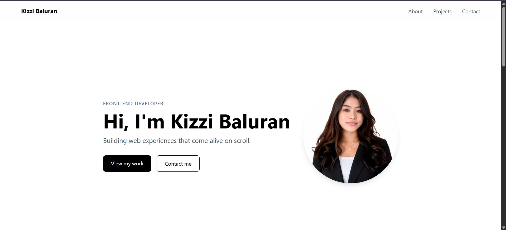

# Kizzi Baluran | Portfolio

A responsive personal portfolio built with React, Tailwind CSS, and GSAP. It introduces me, shares my background, showcases my projects, and links to my GitHub, LinkedIn, and email.

**Live site:** YOUR-LIVE-URL

## Features

- Responsive, mobile-first layout
- GSAP entrance animation in the Hero and ScrollTrigger animation on project cards
- Sticky navbar with a mobile menu
- Project cards with tech tags, screenshots, and links
- React Router setup with a custom 404 page, ready for future pages

## Tech Stack

- React (Vite)
- React Router
- Tailwind CSS
- GSAP and ScrollTrigger
- React Icons
- Deployed on Vercel

## Getting Started

1. Clone the repository:

   git clone https://github.com/kizzibaluran77/kizzi-portfolio.git

2. Go into the folder and install dependencies:

   cd kizzi-portfolio
   npm install

3. Start the dev server:

   npm run dev

4. Build for production:

   npm run build

## Project Structure

src/
  components/   Navbar, Hero, About, Projects, ProjectCard, Contact, Footer
  data/         projects.js (project content)
  pages/        Home, NotFound

## Contact

- Email: kizzibaluran@g.cjc.edu.ph
- GitHub: https://github.com/kizzibaluran77
- LinkedIn: https://www.linkedin.com/in/kizzi-baluran-b85b97446/